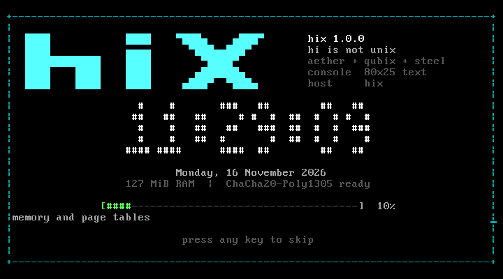
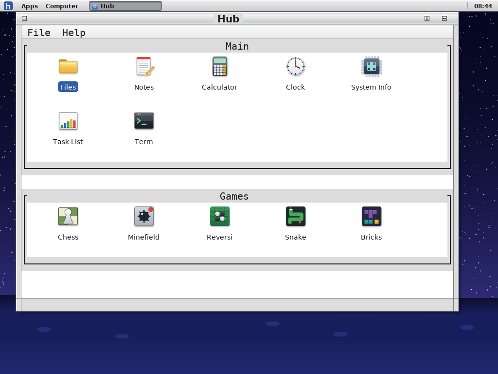
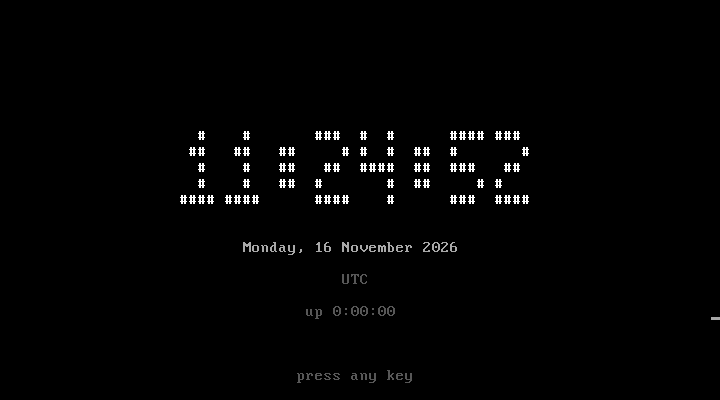
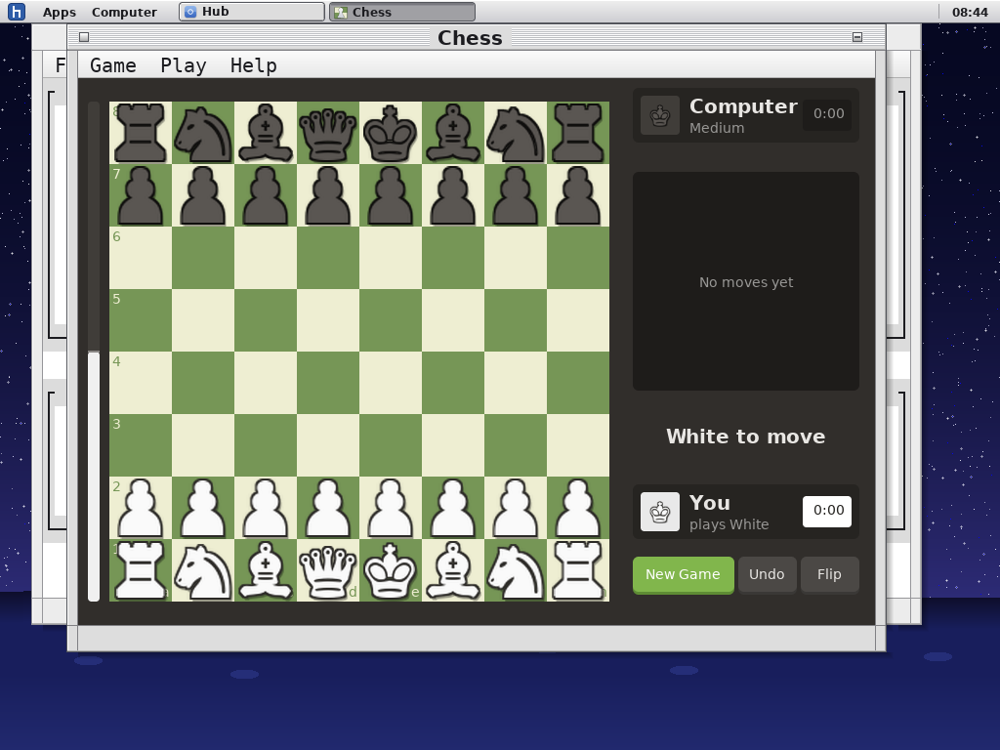
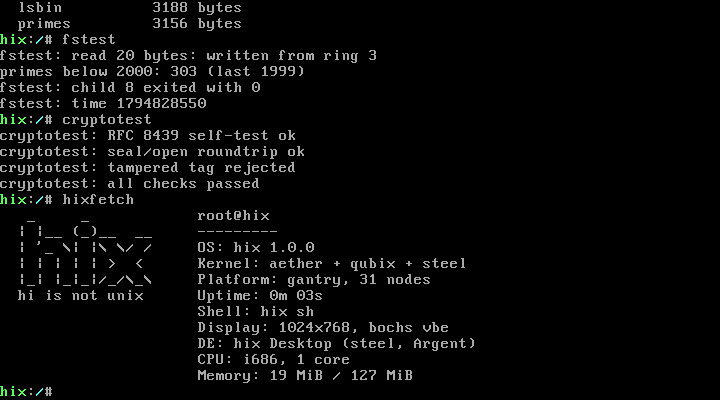

# hix — hi is not unix

Гибридное ядро для i386, выросшее из вашего hi-Kernel 0.1.0. Ядро разделено на
слои со своими именами, код оформлен по Linux coding style. Версия: **1.0.0**.

| Имя | Роль | Где |
|---|---|---|
| **hix** | всё ядро целиком: загрузка, прерывания, printk, panic, драйверы | `arch/` `kernel/` `drivers/` `lib/` |
| **aether** | задачи, потоки, планировщик, порты и IPC, память | `aether/` |
| **qubix** | процессы, системные вызовы, VFS, tty, шелл | `qubix/` |
| **steel** | поверхности, холсты, композитор, консоль, пиксельный режим | `steel/` |
| **desk** | рабочий стол и программы (процесс qubix) | `apps/` `include/desk/` |

## Как это выглядит

| Стартовый экран | Рабочий стол |
|---|---|
|  |  |
| **Скринсейвер** | **Шахматы** |
|  |  |

Снимки сделаны с 1.0.0: splash, шелл и скринсейвер — из QEMU (COM1-сценарий
`scripts/smoke.py`), рабочий стол и шахматы — точный пиксельный кадр
`tests/test_desk` (`make shots`).

## Сборка и запуск

    make              # build/hix.elf (+ build/hix.iso, если есть grub-mkrescue)
    make run          # QEMU напрямую, без GRUB:  qemu-system-i386 -kernel
    make run-serial   # то же + полноценная консоль COM1 в вашем терминале
    make run-iso      # через GRUB
    make config       # показать config/hix.conf (загрузка, скринсейвер)
    make test         # хост-тесты (в т.ч. шахматный движок с perft)
    make check        # стиль + проверка multiboot-заголовка
    make strict       # сборка с -Werror
    make verify       # стиль, тесты, Rust, crypto и кадры — перед релизом
    make smoke        # загрузка в QEMU и проверки через COM1
    make gfxcheck     # desk под -vga std/vmware/cirrus: настоящие пиксели
    make release      # строгая сборка + verify + smoke + dist/ с SHA256SUMS
    make shots        # кадры десктопа в PNG (build/shots)
    make shots-check  # сверка кадров с эталоном (инструмент на Rust, нужен cargo)
    make rust-test    # host-тесты Rust-модуля ядра (cargo)
    make crypto-test  # векторы Python против Rust C ABI
    make rust-sysroot # Debian/Ubuntu: i386 core для Rust в ядре (без root)
    make version      # версия из include/hix/version.h

Нужны: gcc и g++ (с -m32), nasm, ld; для ISO — grub-mkrescue + xorriso; для
запуска — QEMU; для Rust в ядре — стабильный rustc с `core` под
`i686-unknown-linux-gnu` (необязательно, см. [docs/CRYPTO.md](docs/CRYPTO.md)).
Полный список пакетов и разбор ошибок — [docs/INSTALL.md](docs/INSTALL.md).

## Релизы

Версия хранится только в `include/hix/version.h` (`make version`). Релиз
`1.0.0` — первый публичный после `0.3.4`; что изменилось — в
[docs/releases/1.0.0.md](docs/releases/1.0.0.md). `make release` собирает
чистый строгий билд с Rust и ISO, прогоняет `verify` и QEMU smoke, затем
кладёт в `dist/hix-<версия>/` ядро, ISO, документацию, логи и `BUILD-INFO`,
рядом — исходники и `SHA256SUMS`. Процесс тега и публикации описан в
[docs/RELEASE.md](docs/RELEASE.md), схема версий — в
[docs/VERSIONING.md](docs/VERSIONING.md).

## Языки

Ядро hix — C. Слои над ним могут быть на C++ (свободный режим: без
исключений, RTTI и стандартной библиотеки; `new`/`delete` работают поверх
`kmalloc`, конструкторы глобальных объектов вызываются из `cxx_init()`).
Интерфейсы между языками — обычные C-функции (`include/hix/linkage.h`).
Сейчас на C++ написаны шахматные правила (`apps/chess_rules.cpp`), тема
пиксельного десктопа (`steel/theme.cpp`), панели (`steel/panel.cpp`) и **Gantry** —
платформенный слой с реестром устройств и моделью драйверов (`gantry/`).
Python — для автоматизации: `scripts/genfont.py`, `scripts/genicons.py`
(генераторы данных), `scripts/shots.py` (`make shots`: кадры десктопа в PNG),
`scripts/crypto_check.py` (эталонные векторы для криптомодуля).

**Rust в ядре** подключён как необязательный модуль `rust/hix-core`
(`no_std`, ring 0, ChaCha20-Poly1305). Обычный `make` собирает его, если
найден `core` под i686; без него ядро работает, а `SYS_crypto` возвращает
`-ENOSYS`. Сборка, ABI и замена шифра — в [docs/CRYPTO.md](docs/CRYPTO.md).
Python в кольце 0 не запускается: он остаётся эталоном на хосте, а гостевой
Python — задача для ring 3 (например, MicroPython). На Rust также написан
хост-инструмент `tools/shotsum` (без зависимостей, 5 unit-тестов): он считает
контрольные суммы кадров десктопа и сверяет их с эталоном
`tools/shotsum/golden.txt` (`make shots-check`).

## Загрузка и настройка

Стартовый экран (`qubix/splash.c`) показывает логотип, большие часы UTC, дату,
RAM, состояние Rust-криптомодуля и небольшой прогресс-бар; любая клавиша его
пропускает. После этого `init` запускает `sh` с компактной шапкой, а не с
потоком отладочных сообщений. `quiet = on` убирает info/notice из VGA, оставляя
их в `dmesg` и на COM1.

Всё настраивается из хоста через `config/hix.conf` и bash-скрипт
`scripts/hixctl`:

    scripts/hixctl show
    scripts/hixctl splash on|off|seconds N
    scripts/hixctl quiet on|off
    scripts/hixctl screensaver stars|matrix|clock|blank
    scripts/hixctl screensaver timeout N
    scripts/hixctl build | run --serial | check | reset | doctor

`make` сам генерирует `build/hixconfig.h` из `config/hix.conf`, поэтому
отдельный генератор запускать не обязательно. Подробности и рецепты —
[docs/BOOT.md](docs/BOOT.md).

Значения можно перекрыть на один запуск, без пересборки:

    qemu-system-i386 -m 128M -kernel build/hix.elf \
        -append 'hix.splash=4 hix.quiet=0 hix.screensaver=matrix hix.timeout=60'

`hix.safe=1` выключает splash, quiet и скринсейвер; `sysctl hix.boot` и
`sysctl kern.cmdline` показывают принятые значения. COM1 — полноценная
консоль, а не только лог: `make run-serial` позволяет вводить команды, а в
GRUB-меню есть отдельный пункт `serial console`.

Скринсейверы (`stars`, `matrix`, `clock`, `blank`) — обычные qprog-программы:
запускаются вручную командой `screensaver NAME` или сами после
`screensaver_timeout` секунд простоя; любая клавиша возвращает в шелл и
сохраняет недопечатанную строку. Гостевого bash нет — qubix использует свой
шелл, поэтому bash-слой живёт на хосте.

## Графика (steel)

Если ядро находит **Bochs VBE** (QEMU с `-vga std`, это значение по
умолчанию; также Bochs и VirtualBox) или **VMware SVGA II** (VMware
Workstation/Fusion/ESXi и QEMU с `-vga vmware`), steel переключается в
**1024x768x32**: гладкий шрифт, пиксельный курсор мыши, холсты с
альфа-смешиванием, скруглённые прямоугольники. При выходе из desk текстовый
режим программируется заново (регистры VGA и шрифт). В полноэкранном QEMU
картинка иногда растягивается — это масштабирование окна самим QEMU,
помогает повторный вход/выход из fullscreen или `-display sdl` /
`-display gtk,zoom-to-fit=off`. На другом железе остаётся обычный текстовый
режим 80x25 — всё работает и там, только без пиксельных программ. Адаптер
виден в `sysctl hw.display` (`bochs vbe`, `vmware svga` или `vga text`).

Рабочий стол по-прежнему говорит клетками 80x25; «дырки» в сетке клеток
показывают пиксельные холсты программ, поэтому окна перекрываются как обычно.
Программа регистрирует холст через `steelctl(STEEL_CTL_CLIENT_SET)` и сообщает
об изменениях через `STEEL_CTL_CLIENT_DIRTY`.

### Тема Argent

В пиксельном режиме клетки с ролью (заголовок окна, рамка, кнопка, иконка …)
рисует тема, а не шрифт: платиново-серые окна с полосатым заголовком, мягкие тени,
закруглённые кнопки, 48x48 иконки, обои. Окна пока выровнены по сетке клеток
(12x28 пикселей); пиксельная раскладка окон и виджеты — после 1.0.0.

## Рабочий стол (desk)

В шелле команда `desk` включает рабочий стол: Hub с группами Main и Games,
окна с меню, перетаскивание, сворачивание, двойной клик по иконке, Alt+Tab,
Alt+F4. Нужна PS/2-мышь (в QEMU есть); клавиатура работает всегда.

| Программа | Что это |
|---|---|
| Files, Notes | файлы qubix-VFS: просмотр, правка, сохранение |
| Calculator, Clock | калькулятор (слева направо), часы по RTC |
| System Info, Task List | данные `sysctl` и список процессов |
| Term | командная строка внутри окна |
| Minefield, Reversi, Snake, Bricks | игры; правила отделены от окон (`include/desk/games.h`) |
| **Chess** | шахматы в пиксельном режиме, см. ниже |

`desk chess` (или просто `chess` в шелле) открывает стол сразу с шахматами.

### Chess

Движок (`apps/chess_rules.c`): полные правила — рокировка, взятие на проходе,
превращение, мат, пат, троекратное повторение, правило 50 ходов, недостаток
материала; проверен счётом `perft`. Игрок против компьютера (4 уровня:
альфа-бета с форсированным поиском) или вдвоём за одним экраном.

Интерфейс: доска 8x8 с подсветкой последнего хода и точками возможных ходов,
перетаскивание фигур мышью или клик-клик, выбор фигуры при превращении,
анимация хода, шкала оценки, карточки игроков с часами, запись партии в
алгебраической нотации, кнопки New Game / Undo / Flip, меню Game / Play / Help.

## Шелл

Строка редактируется на месте (стрелки, Home/End, Ctrl-A/E/K/U/W/L), есть
история (↑/↓), Tab-дополнение команд и путей, переменные (`set X=1`, `$X`,
`$?`), кавычки, `;`, перенаправление `>` и `>>`, текущий каталог.

`help` · `ls [-l]` `cd` `pwd` `cat` `echo` `mkdir` `rm` `touch` `cp` `mv` `wc`
`head` `grep` · `ps` `top` `free` `mem` `devtree` `irqs` `dmesg` `sysctl` ·
`set` `unset` `history` · `run` `progs` `ipc` `desk` `gfx` `crypto`
`splash` `screensaver` · `date` `uptime`
`uname` `sleep` · `crash` `panic` `reboot` `halt` `exit`.

`kill PID` завершает процесс на ближайшем системном вызове; pid 0 и 1
защищены. У потоков ядра отмены по-прежнему нет.

## Важно

Сборка проверена на хосте (тесты, `-Werror`, разбор ELF/multiboot, снимки
пиксельного вывода), а `build/hix.elf` загружался в QEMU через `-kernel`:
ядро доходит до `boot complete, starting the scheduler`, Rust-модуль
проходит self-test, команды `crypto` и `cryptotest` работают. `make smoke`
автоматически проверяет загрузку, splash, `uname`, `crypto`, `kitinfo`,
`lsbin`, `fstest`, `cryptotest`, `hixfetch`, скринсейвер и `halt`;
`make gfxcheck` дополнительно запускает desk под QEMU с `-vga std`,
`-vga vmware` и `-vga cirrus` и проверяет настоящий экран: пиксельные кадры,
перерисовку после F9 и возврат в текстовый режим. Полный набор сценариев
рабочего стола в QEMU по-прежнему не прогоняется. Если ядро
не стартует, пришлите вывод `make run-serial` или `build/smoke/serial.log`.

Установка: [docs/INSTALL.md](docs/INSTALL.md), архитектура:
[docs/ARCHITECTURE.md](docs/ARCHITECTURE.md), стиль:
[docs/CODING-STYLE.md](docs/CODING-STYLE.md), загрузка и кастомизация:
[docs/BOOT.md](docs/BOOT.md), SDK: [docs/SDK.md](docs/SDK.md), криптография и
Rust: [docs/CRYPTO.md](docs/CRYPTO.md), релизы:
[docs/RELEASE.md](docs/RELEASE.md), версии:
[docs/VERSIONING.md](docs/VERSIONING.md), авторы и шрифты:
[docs/CREDITS.md](docs/CREDITS.md), история: [docs/CHANGELOG.md](docs/CHANGELOG.md).
